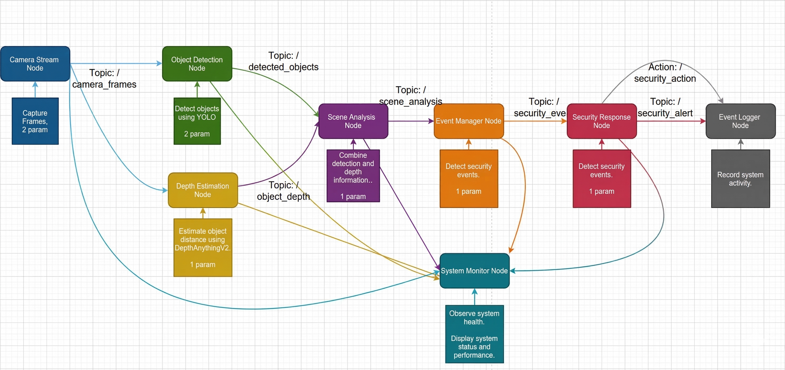
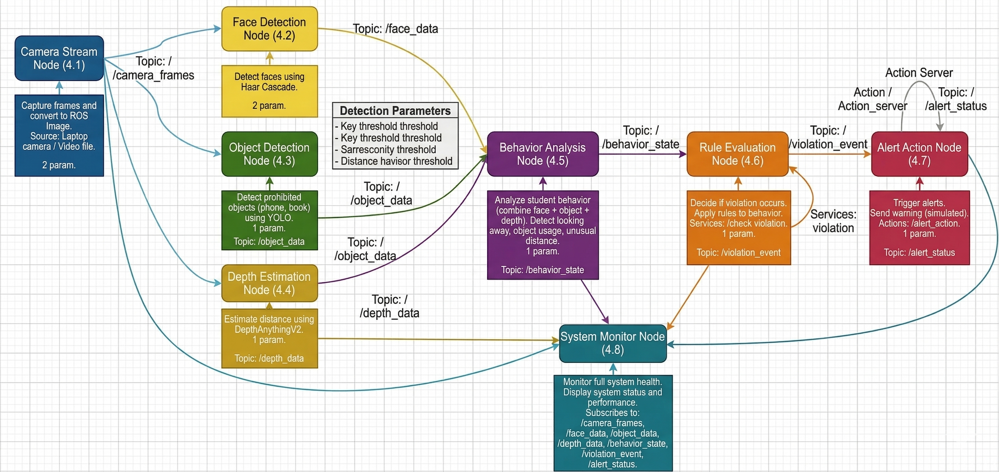
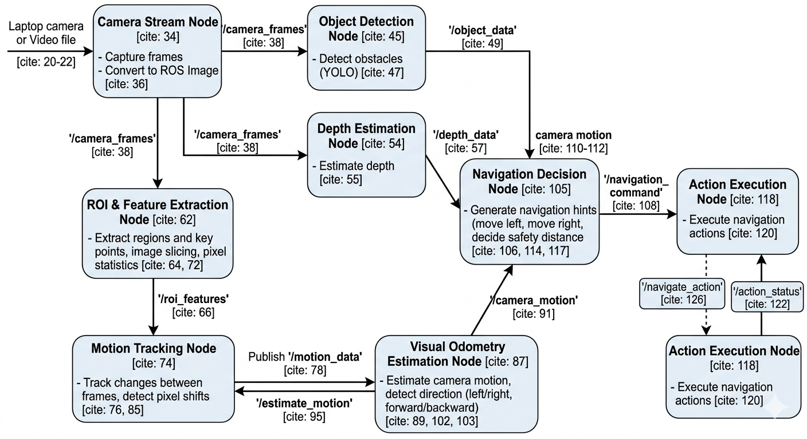
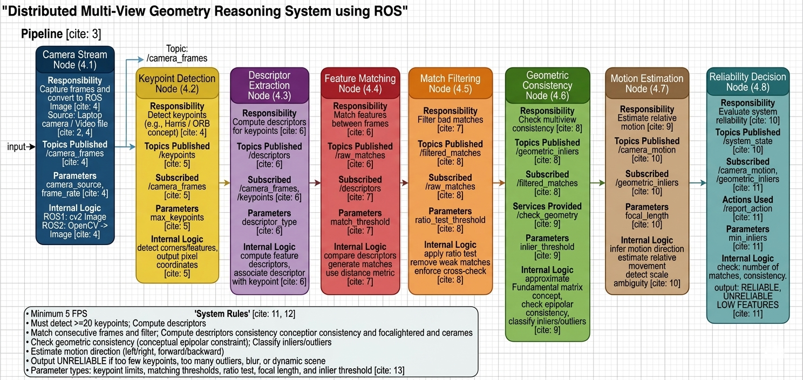

# ROS 2 Distributed Robotics & Computer Vision Systems

<p align="center">
  
  
  
  
  
</p>

> **Author:** Abd El-Rhman Muhammad Saad  
> **Academic Institution:** Faculty of Engineering, Alexandria University  
> **Specialization:** Robotics & Distributed Software Integration (`ROS 2 Jazzy`)  
> **Core Framework:** ROS 2 Jazzy (`rclpy`), OpenCV, YOLOv8, DepthAnythingV2 & Epipolar Geometry  
> **Collaborative Engineering Team:** Abd El-Rhman Saad, Tasneem El-Shandidi, Mariam Mamdouh, Rowan Tamer, Nada Mahmoud, Marina Said, Razan Ramzy, Asmaa Galal  
> **Project Repository:** [ROS2-Projects on GitHub](https://github.com/Abd-El-Rhman-Saad/ROS2-Projects) *(forked from [Rowan-35/ROS2-Projects-](https://github.com/Rowan-35/ROS2-Projects-))*

---

## 1. Executive Summary & Scope

This repository contains five coursework **ROS 2 Jazzy** distributed multi-node systems developed in Python (`rclpy`) by an 8-student engineering team. The systems cover multi-agent grid fleet coordination, security surveillance, exam proctoring, visual navigation hints, and multi-view projective geometry.

> **Simulation & Testing Scope:** All five subsystems are software-only implementations tested in simulation and against pre-recorded test videos or laptop webcams (no physical robot hardware or actuators were used).

Each system is decomposed into independent ROS 2 nodes communicating through publish/subscribe topics, synchronous request/reply services, action servers/clients, and node-level ROS 2 parameters.

```
+==================================================================================================+
|                        ROS 2 JAZZY DISTRIBUTED SYSTEMS SUITE                                     |
+==================================================================================================+
|                                                                                                  |
|  [System 1: Grid Fleet Coordination]          [System 2: Smart Security Surveillance]            |
|  * 4 Nodes | Discrete 8x8 Grid Simulation     * 8 Nodes | Webcam / Recorded Video Stream         |
|  * Decentralized Cell Reservation             * YOLOv8 Object Detection + DepthAnythingV2        |
|  * Task Allocation & Move Services            * Event Manager, Alert Logging & System Monitor    |
|                                                                                                  |
|  [System 3: Smart Exam Proctoring]            [System 4: Visual Navigation Hint System]          |
|  * Multi-Modal Visual Pipeline                * 8 Nodes | Monocular Obstacle Avoidance Hints     |
|  * Haar Cascades + YOLOv8 + Depth             * ROI Feature Extraction + Visual Odometry         |
|  * Behavior Analysis & Alert Status           * Navigation Decision & Action Execution           |
|                                                                                                  |
|  [System 5: Multi-View Geometry Reasoning]                                                       |
|  * Epipolar Geometry Pipeline                                                                    |
|  * ORB Keypoints + Lowe's Ratio Test + RANSAC Fundamental Matrix                                 |
|  * Essential Matrix Pose Estimation (R, t) & Reliability Decision                                |
+==================================================================================================+
```

---

## 2. Personal Contribution (Nodes Authored & Integrated)

This monorepo is a collaborative 8-member team project where each member implemented and integrated specific nodes across the systems. My direct code contributions are:

| Subsystem | Node Authored / Co-Authored | Source File | Role & Implementation Summary |
| :--- | :--- | :--- | :--- |
| **System 2: Security Surveillance** | **Node 4.5 — Event Manager** | `event_manager_node.py` | Subscribes to `/scene_analysis`, evaluates `restricted_objects` and proximity flags, and publishes JSON event payloads on `/security_event`. |
| **System 3: Exam Proctoring** | **Node 4.5 — Behavior Analysis** | `behavior_analysis_node.py` | Synchronizes `/face_coordinates`, `/object_data`, and `/object_depth` at 5 Hz (`0.2 s` timer) to detect prohibited objects, looking away, and unusual screen distance, publishing `/behavior_state`. |
| **System 4: Visual Navigation** | **Node 4.7 — Navigation Decision** *(with Mariam Mamdouh)* | `navigation_node.py` | Subscribes to `/camera_motion`, `/object_data`, and `/depth_data` at 5 Hz to evaluate `safety_distance` and motion reliability, publishing directional commands (`move forward`, `move left`, `move right`, `stop`) on `/navigation_command`. |
| **System 5: Multi-View Geometry** | **Node 4.8 — Reliability Decision** *(with Mariam Mamdouh)* | `reliability_decision_node.py` | Subscribes to `/geometric_inliers` (`FeatureMatchArray`) and `/camera_motion` at 5 Hz, evaluating `min_inliers` and motion confidence to publish `RELIABLE` / `UNRELIABLE` states on `/system_state`. |
| **System 1: Grid Fleet Coordination** | Team Coursework Package | `fleet_coordination/` | Collaborative team assignment (node implementation led by Rowan Tamer). |

---

## 3. Master System Comparison Matrix

| Subsystem Name | Domain Focus | Sensor / Test Inputs | Primary Stack | Communication Protocols | Key Interfaces | Output Decisions |
| :--- | :--- | :--- | :--- | :--- | :--- | :--- |
| **1. Grid Fleet Coordination** | Multi-Agent Grid Logistics | Simulated $8 \times 8$ Grid Coordinates | Pure Python (`rclpy`) | Topics, Services | `VehicleState.msg`<br>`RequestTask.srv`<br>`RequestMove.srv` | Cell reservations, step approvals, deadlock warnings |
| **2. Security Surveillance** | Threat Detection & Monitoring | USB Webcam / Recorded Video | YOLOv8, DepthAnythingV2 | Topics, Actions, Parameters | `sensor_msgs/Image`<br>`std_msgs/String`<br>`/security_action` | Threat classification, distance alerts, event logs |
| **3. Exam Proctoring** | Academic Integrity Monitoring | Webcam / Recorded Exam Video | Haar Cascades, YOLOv8, DepthAnythingV2 | Topics, Parameters | `sensor_msgs/Image`<br>`std_msgs/String` | Looking-away flags, phone/book detection, alert status |
| **4. Visual Navigation** | Obstacle Avoidance Hints | Monocular Video / Webcam | YOLOv8, DepthAnythingV2, ORB/ROI | Topics, Actions, Services | `ROIFeatures.msg`<br>`MotionData.msg`<br>`/navigate_action` | Directional hints (`move forward`, `move left`, `move right`, `stop`) |
| **5. Multi-View Geometry** | Spatial Reasoning & Pose | Consecutive Monocular Frames | ORB, BFMatcher, RANSAC, `recoverPose` | Topics, Services | `multi_view_interfaces`<br>`std_msgs/String`<br>`/check_geometry` | Fundamental/Essential Matrix, $[R \mid t]$ direction, reliability state |

---

## 4. Subsystem 1: Distributed Grid Fleet Coordination System

The **Grid Fleet Coordination System** simulates automated guided vehicles (AGVs) operating across a discrete $8 \times 8$ warehouse grid ($X, Y \in [0, 7]$), handling task allocation, cell reservation, and deadlock monitoring.

```
       +--------------------+                    +-----------------------+
       |    Task Manager    |                    |   Traffic Controller  |
       |  (Task Allocation) |                    |  (Collision Avoidance)|
       +--------------------+                    +-----------------------+
                 |                                           |
                 | Service: /request_task                    | Service: /request_move
                 v                                           v
       +-------------------------------------------------------------+
       |                     Vehicle Node (FSM)                      |
       |  State: IDLE -> REQUEST_TASK -> MOVING_TO_PICKUP -> ...     |
       +-------------------------------------------------------------+
                                     |
                                     | Topic: /vehicle_state (10 Hz)
                                     v
                       +----------------------------+
                       |        Monitor Node        |
                       |    (Real-Time Dashboard)   |
                       +----------------------------+
```

### 4.1 Node Responsibilities
* **`task_manager`:** Generates 10 randomized pickup/dropoff missions and serves `/request_task` one mission at a time.
* **`traffic_controller`:** Arbitrates single-cell moves via `/request_move`, checking grid bounds ($0 \le x, y \le 7$), cell occupancy, and wait timers ($t_{\text{wait}} > 5.0\text{ s}$ deadlock detection).
* **`vehicle_node`:** Executes a Finite State Machine (`IDLE` $\to$ `REQUEST_TASK` $\to$ `MOVING_TO_PICKUP` $\to$ `MOVING_TO_DROPOFF` $\to$ `FINISHED`).
* **`monitor_node`:** Subscribes to `/vehicle_state` to display active, idle, and completed vehicle states.

---

## 5. Subsystem 2: Distributed Smart Security Surveillance System

The **Smart Security Surveillance System** processes webcam or recorded video streams to detect objects, estimate relative depth, flag proximity or restricted-item events, and log security alerts.

<p align="center">
  
</p>

### 5.1 Vision Pipeline & Multi-Node Flow
1. **`camera_stream_node`:** Reads webcam or video files and publishes `sensor_msgs/msg/Image` on `/camera_frames`.
2. **`object_detection_node`:** Runs **YOLOv8** (`yolov8n.pt`) on incoming frames and publishes detections on `/detected_objects`.
3. **`depth_estimation_node`:** Runs **DepthAnythingV2** (`vits`) to publish depth maps on `/object_depth`.
4. **`Scene_Analysis_Node`:** Combines bounding boxes and depth values against `danger_distance` (`1.5 m`), publishing close objects on `/scene_analysis`.
5. **`event_manager_node`:** Checks `/scene_analysis` against `restricted_objects` and proximity flags, publishing JSON payloads on `/security_event`.
6. **`security_response_node`:** Assesses event severity (`low`/`medium`/`high`), publishes `/security_alert`, and dispatches goals to `/security_action` (using `example_interfaces/action/Fibonacci` as an action placeholder).
7. **`event_logger_node` & `SystemMonitorNode`:** Persist `/security_event` and `/security_alert` logs to disk and monitor topic activity.

---

## 6. Subsystem 3: Distributed Smart Exam Proctoring System

Designed to monitor simulated exam sessions from webcam or recorded video files, this pipeline detects faces, prohibited items (phones and books), and screen distance.

<p align="center">
  
</p>

### 6.1 Pipeline Nodes
* **`camera_stream_node`:** Publishes video frames to `/camera_frames` at a configurable `frame_rate` (default `10 Hz`).
* **`object_detection_node`:** Runs **YOLOv8** filtered to COCO classes `67` (`cell phone`) and `73` (`book`), publishing `/object_data`.
* **`depth_estimation_node`:** Estimates depth maps using **DepthAnythingV2** on `/object_depth`.
* **`behavior_analysis_node`:** Combines `/face_coordinates`, `/object_data`, and `/object_depth` at 5 Hz to flag `object_usage`, `looking_away` (side face), and `unusual_distance` ($< 1.0\text{ m}$), publishing `/behavior_state`.
* **`alert_action_node`:** Subscribes to `/violation_event` and publishes formatted alert strings to `/alert_status`.

---

## 7. Subsystem 4: Distributed Visual Navigation Hint System

This system generates directional obstacle-avoidance hints from monocular video streams using object detection, depth estimation, ROI feature tracking, and visual odometry.

<p align="center">
  
</p>

### 7.1 Guidance Pipeline
1. **`camera_stream_node` & `object_detection_node` & `depth_estimation_node`:** Publish `/camera_frames`, `/object_data`, and `/depth_data`.
2. **`feature_extraction_node`:** Splits frames into a $3 \times 4$ grid of ROIs, computing HSV statistics, Canny edge centroids, and ORB keypoint counts published via `navigation_msgs/msg/ROIFeatures` on `/roi_features`.
3. **`motion_tracking_node`:** Tracks ROI centroid displacements across frames and publishes `navigation_msgs/msg/MotionData` on `/motion_data`.
4. **`visual_odometry_node`:** Estimates camera motion direction, blur variance, and reliability on `/camera_motion` (plus `/estimate_motion` trigger service).
5. **`navigation_node`:** Evaluates `/camera_motion`, `/object_data`, and `/depth_data` at 5 Hz against `safety_distance` (`1.5 m`) and publishes hints (`move forward`, `move left`, `move right`, `stop`) on `/navigation_command`.
6. **`action_execution_node`:** Hosts the `/navigate_action` Action Server and publishes status strings to `/action_status`.

---

## 8. Subsystem 5: Distributed Multi-View Geometry Reasoning System

This subsystem performs keypoint detection, ORB descriptor extraction, Lowe's ratio test matching, RANSAC Fundamental Matrix filtering, camera pose estimation, and reliability evaluation across consecutive frames.

<p align="center">
  
</p>

### 8.1 Mathematical Foundations
For consecutive camera views observing a 3D point $P$, normalized image coordinates $x_1$ and $x_2$ satisfy the epipolar constraint:

$$x_2^T E x_1 = 0, \quad E = [t]_\times R$$

where $E$ is the Essential Matrix, $R \in SO(3)$ is relative rotation, and $t \in \mathbb{R}^3$ is relative translation, using the camera intrinsic matrix $K$:

$$K = \begin{bmatrix} f & 0 & c_x \\ 0 & f & c_y \\ 0 & 0 & 1 \end{bmatrix}$$

### 8.2 Multi-Node Pipeline
* **`keypoint_detection_node` (Node 4.2):** Extracts up to 200 ORB keypoints on `/keypoints` (warns if $< 20$ keypoints).
* **`descriptor_extraction_node` (Node 4.3):** Synchronizes `/camera_frames` and `/keypoints` (`ApproximateTimeSynchronizer`) to publish ORB descriptors on `/descriptors`.
* **`feature_matching_node` (Node 4.4):** Matches consecutive frames using `cv2.BFMatcher(cv2.NORM_HAMMING)` and Lowe's ratio test (`0.75`), publishing `/raw_matches`.
* **`geometric_consistency_node` (Node 4.6):** Runs `cv2.findFundamentalMat(..., cv2.FM_RANSAC)` to publish `/geometric_inliers` and serves `/check_geometry`.
* **`motion_estimation_node` (Node 4.7):** Computes `cv.findEssentialMat` and `cv.recoverPose` to publish directional motion strings on `/camera_motion`.
* **`reliability_decision_node` (Node 4.8):** Evaluates `min_inliers` ($8$) and `min_motion_confidence` ($0.4$) at 5 Hz to publish `RELIABLE` or `UNRELIABLE` on `/system_state`.

---

## 9. Custom ROS 2 Interface Definitions Included

### 9.1 `fleet_interfaces` (System 1)
* `msg/VehicleState.msg`: `string vehicle_id`, `string current_state`, `int32 x`, `int32 y`
* `srv/RequestTask.srv`: `string vehicle_id` $\to$ `bool success`, `int32 pickup_x`, `int32 pickup_y`, `int32 dropoff_x`, `int32 dropoff_y`
* `srv/RequestMove.srv`: `string vehicle_id`, `int32 current_x`, `int32 current_y`, `int32 target_x`, `int32 target_y` $\to$ `bool approved`

### 9.2 `navigation_msgs` (System 4)
* `msg/ROIFeatures.msg`: `num_rois`, `roi_ids`, `centroids_x/y`, `mean_hue/saturation/value`, `keypoint_count`, `bbox_x/y/w/h`
* `msg/MotionData.msg`: `std_msgs/Header header`, `avg_dx`, `avg_dy`, `displacements_x`, `displacements_y`, `num_matches`, `confidence`

---

## 10. Workspace Setup & Build Notes

### 10.1 Environment Prerequisites
* **Operating System:** Ubuntu 24.04 LTS (Noble Numbat)
* **ROS 2 Distribution:** ROS 2 Jazzy Jalisco (`rclpy`)
* **Python Dependencies:** Python $\ge 3.12$, `torch`, `torchvision`, `ultralytics`, `opencv-python`, `numpy`

```bash
sudo apt update && sudo apt install -y \
  ros-jazzy-cv-bridge \
  ros-jazzy-image-transport \
  ros-jazzy-message-filters \
  python3-colcon-common-extensions

pip3 install torch torchvision opencv-python numpy ultralytics
```

### 10.2 Cloning & Building
```bash
mkdir -p ~/ros2_ws/src
cd ~/ros2_ws/src
git clone https://github.com/Abd-El-Rhman-Saad/ROS2-Projects.git .
```

> **Build Scope Note:** `fleet_coordination` + `fleet_interfaces` (System 1) include complete build manifests and custom `.msg`/`.srv` definitions and build directly via `colcon build --packages-select fleet_interfaces fleet_coordination`. For the vision systems, `navigation_msgs` is included for System 4, while `custom_msgs` (System 2 `Scene_Analysis_Node.py`), `action_pkg` (System 4 `action_execution_node.py`), and `multi_view_interfaces` (System 5) are external interface packages not bundled in this repository; additionally, video paths in `camera_stream_node.py` point to local test files and should be updated (or set to webcam `0`) before running.

```bash
# Example: Building and running System 1 (Grid Fleet Coordination)
cd ~/ros2_ws
colcon build --packages-select fleet_interfaces fleet_coordination
source install/setup.bash

ros2 run fleet_coordination task_manager
ros2 run fleet_coordination traffic_controller
ros2 run fleet_coordination vehicle_node vehicleA
ros2 run fleet_coordination monitor_node
```

---

## 11. Repository Structure

```
ROS2-Projects/
├── images/                                                # System architecture diagrams
│   ├── surveillance_pipeline_architecture.png
│   ├── exam_proctoring_system_diagram.png
│   ├── visual_navigation_structure.png
│   └── multiview_geometry_reasoning_pipeline.png
├── docs/
│   └── Task2_Robotics_Specification.pdf                   # Coursework specification document
├── Distributed Grid Fleet Coordination System/            # System 1 (fleet_coordination + fleet_interfaces)
│   ├── nodes/
│   ├── setup/
│   ├── fleet_interfaces/
│   ├── package.xml
│   └── setup.py
├── Distributed Smart Security Surveillance System using ROS/ # System 2 (smart_security_system)
│   ├── nodes/
│   ├── package.xml
│   ├── setup.py
│   └── System_structure.png
├── Distributed Smart Exam Proctoring System using ROS/    # System 3 (exam_proctoring_system)
│   ├── nodes/
│   ├── package.xml
│   ├── setup.py
│   └── system_diagram.png
├── Distributed Visual Navigation Hint System using ROS/   # System 4 (navigation_hint_system + navigation_msgs)
│   ├── nodes/
│   ├── navigation_msgs/
│   ├── package.xml
│   └── setup.py
├── Distributed Multi-View Geometry Reasoning System using ROS/ # System 5 (multi_view_geometry)
│   ├── nodes/
│   ├── package.xml
│   ├── setup.py
│   └── system structure.png
└── README.md
```

---

## 12. Authors & Academic Attribution

```
Abd El-Rhman Muhammad Saad
Department of Electrical Power and Machines Engineering
Faculty of Engineering, Alexandria University
Alexandria, Egypt
```
* **GitHub:** [@Abd-El-Rhman-Saad](https://github.com/Abd-El-Rhman-Saad)
* **LinkedIn:** [Abd El-Rhman Saad](https://linkedin.com/in/Abd-El-Rhman-Saad)
* **Email:** [abdelrhmanmsaad22@gmail.com](mailto:abdelrhmanmsaad22@gmail.com)

**Collaborative Team:**  
**Abd El-Rhman Saad**, **Tasneem El-Shandidi**, **Mariam Mamdouh**, **Rowan Tamer**, **Nada Mahmoud**, **Marina Said**, **Razan Ramzy**, and **Asmaa Galal**.
