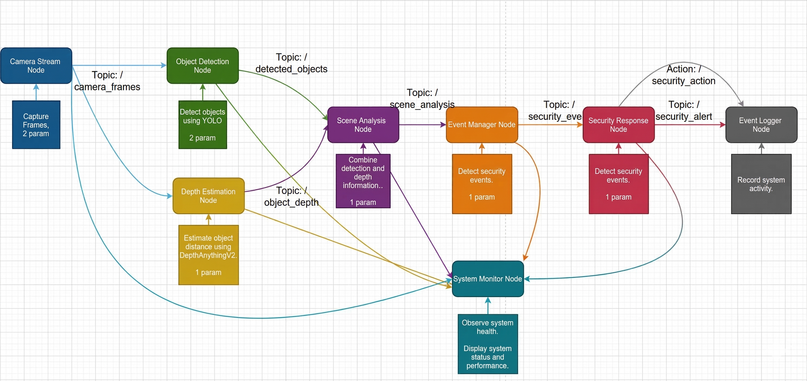
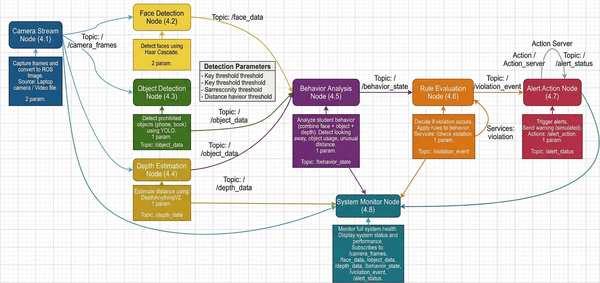
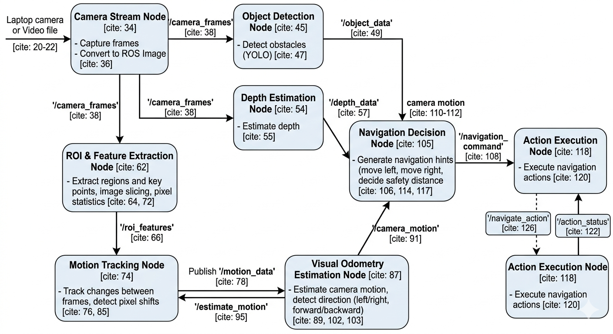
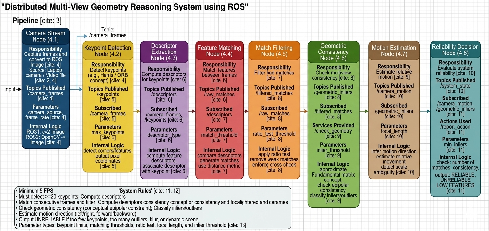

# ROS 2 Distributed Robotics & Computer Vision Systems

<p align="center">
  
  
  
  
  
</p>

> **Project Engineer:** Abd El-Rhman Muhammad Saad  
> **Academic Institution:** Faculty of Engineering, Alexandria University (Class of 2026)  
> **Specialization:** Autonomous Robotics & Distributed Embedded Systems  
> **Core Framework:** ROS 2 (`rclpy`), Distributed Edge AI, Multi-Agent Coordination & Epipolar Geometry  
> **Collaborative Engineering Team:** Abd El-Rhman Saad, Tasneem El-Shandidi, Mariam Mamdouh, Rowan Tamer, Nada Mahmoud, Marina Said, Razan Ramzy, Nourhan El-Sayed  
> **Project Repository:** [ROS2-Projects on GitHub](https://github.com/Abd-El-Rhman-Saad/ROS2-Projects-)

---

## 1. Executive Summary & Monorepo Architecture

This repository hosts an industrial-grade **Distributed Multi-Robot & Edge Computer Vision Suite** engineered on the **ROS 2 (Robot Operating System 2)** framework using `rclpy`. The codebase implements five decoupled, high-performance distributed systems designed to solve complex challenges in multi-agent fleet scheduling, intelligent surveillance, academic proctoring, visual obstacle avoidance, and multi-view projective geometry.

Unlike monolithic software patterns, each subsystem in this suite is strictly decomposed into a **Distributed Micro-Node Topology**. Individual computational tasks—ranging from frame acquisition and deep-learning inference to spatial geometry reasoning and safety monitoring—operate as independent ROS 2 nodes executing in isolated process spaces. Inter-node synchronization is achieved through an optimal blend of asynchronous publish/subscribe message streams, deterministic synchronous request/reply services, non-blocking goal-oriented action servers, and dynamic parameter reconfigurations.

```
+==================================================================================================+
|                        ROS 2 DISTRIBUTED ROBOTICS & VISION SUITE                                 |
+==================================================================================================+
|                                                                                                  |
|  [System 1: Grid Fleet Coordination]          [System 2: Smart Security Surveillance]            |
|  * 4 Nodes | Discrete 8x8 Grid World          * 8 Nodes | Continuous Video Stream                |
|  * Decentralized Collision Avoidance          * YOLOv8 Object Detection + DepthAnythingV2        |
|  * Dynamic Task Allocation Service            * Action-Driven Security Alerts & Logging          |
|                                                                                                  |
|  [System 3: Smart Exam Proctoring]            [System 4: Visual Navigation Hint System]          |
|  * 8 Nodes | Multi-Modal Visual AI            * 8 Nodes | Real-Time Obstacle Avoidance           |
|  * Haar Cascades + YOLOv8 + Depth             * Dynamic ROI Tracking + Visual Odometry           |
|  * Behavioral Rule Violation Engine           * Closed-Loop Steering Action Server               |
|                                                                                                  |
|  [System 5: Multi-View Geometry Reasoning]                                                       |
|  * 8 Nodes | Epipolar Geometry Pipeline                                                          |
|  * ORB/Harris Keypoints + Ratio Test Match Filtering                                             |
|  * Essential Matrix Estimation & 6-DOF Camera Pose Recovery (R, t)                               |
+==================================================================================================+
```

---

## 2. Master System Comparison Matrix

The following matrix provides an architectural breakdown of the five operational systems included in this monorepo:

| Subsystem Name | Domain Focus | Node Count | Sensor Inputs | Primary AI & Algorithmic Stack | Communication Protocols | Key Custom Interfaces | Real-Time Output Decisions |
| :--- | :--- | :---: | :--- | :--- | :--- | :--- | :--- |
| **1. Grid Fleet Coordination** | Multi-Agent Systems & Logistics | **4** | Virtual Odometry & Grid Feedback | Decentralized Reservation, Deadlock Detection | Topics, Services | `VehicleState.msg`<br>`RequestTask.srv`<br>`RequestMove.srv` | Cell reservations, step approvals, deadlock alarms |
| **2. Security Surveillance** | Threat Detection & Facility Monitoring | **8** | RGB Video / USB Webcam | YOLOv8 Object Detection, DepthAnythingV2 Metric Depth | Topics, Actions, Parameters | `sensor_msgs/Image`<br>`vision_msgs/Detection2D`<br>`/security_action` | Threat classification, distance gating, security alerts |
| **3. Exam Proctoring** | Academic Integrity & Anomaly Detection | **8** | Student Web Camera Stream | Haar Cascade Face Detection, YOLOv8 (Phones/Books), Depth | Topics, Services, Actions | `sensor_msgs/Image`<br>`/check_violation.srv`<br>`/alert_action` | Head pose monitoring, unauthorized object alerts |
| **4. Visual Navigation** | Obstacle Clearance & Guidance | **8** | Monocular Camera Stream | YOLOv8, DepthAnythingV2, Lucas-Kanade Feature Shifts | Topics, Actions | `sensor_msgs/Image`<br>`geometry_msgs/Twist`<br>`/navigate_action` | Directional evasion hints (Left/Right/Halt) |
| **5. Multi-View Geometry** | 3D Spatial Reasoning & Odometry | **8** | Consecutive Monocular Video Frames | Harris/ORB Features, Lowe's Ratio Test, Epipolar Geometry | Topics, Services, Actions | `Float32MultiArray`<br>`/check_geometry.srv`<br>`/report_action` | Essential Matrix $E$, Camera Pose $[R \mid t]$, Reliability State |

---

## 3. Subsystem 1: Distributed Grid Fleet Coordination System

The **Grid Fleet Coordination System** manages autonomous automated guided vehicles (AGVs) operating across a discrete $8 \times 8$ logical warehouse grid ($X, Y \in [0, 7]$). It prevents physical collisions, eliminates grid deadlocks, and manages dynamic pickup-and-delivery logistics.

```
       +--------------------+                    +-----------------------+
       |    Task Manager    |                    |   Traffic Controller  |
       |  (Task Allocation) |                    |  (Collision Avoidance)|
       +--------------------+                    +-----------------------+
                 |                                           |
                 | Service: /request_task                    | Service: /request_move
                 v                                           v
       +-------------------------------------------------------------+
       |                     Vehicle Node (FSM)                      |
       |  State: IDLE -> REQUEST_TASK -> MOVING_TO_PICKUP -> ...     |
       +-------------------------------------------------------------+
                                     |
                                     | Topic: /vehicle_state (10 Hz)
                                     v
                       +----------------------------+
                       |        Monitor Node        |
                       |    (Real-Time Dashboard)   |
                       +----------------------------+
```

### 3.1 Node Responsibilities & Concurrency
* **`task_manager`:** Generates and maintains a backlog of randomized transport missions (pickup and dropoff coordinates). It exposes the `/request_task` service, dispensing jobs strictly one at a time and preventing duplicate assignments.
* **`traffic_controller`:** Acts as the spatial arbiter. Before any vehicle executes a one-cell movement, it calls `/request_move`. The controller verifies:
  1. **Boundary Limits:** $0 \le x_{\text{target}}, y_{\text{target}} \le 7$.
  2. **Cell Occupancy:** Ensures target cell is unoccupied.
  3. **Deadlock Detection:** Tracks wait timers per vehicle; flags a system alert if a vehicle remains blocked for $t_{\text{wait}} > 5.0\text{ s}$.
* **`vehicle_node`:** Implements an internal Finite State Machine (FSM):
  $$\text{IDLE} \xrightarrow{\text{task}} \text{REQUEST\_TASK} \xrightarrow{\text{received}} \text{MOVING\_TO\_PICKUP} \xrightarrow{\text{arrived}} \text{MOVING\_TO\_DROPOFF} \xrightarrow{\text{delivered}} \text{FINISHED}$$
* **`monitor_node`:** Subscribes to `/vehicle_state`, computing active missions, idle fleets, completed delivery counts, and detecting frozen nodes.

---

## 4. Subsystem 2: Distributed Smart Security Surveillance System

The **Smart Security Surveillance System** implements an automated vision pipeline capable of detecting unauthorized persons, tracking suspicious physical objects, estimating metric distance, and dispatching security counteractions.

<p align="center">
  
</p>

### 4.1 Vision Pipeline & Multi-Node Flow
1. **`camera_stream`:** Captures raw video frames from USB webcams or video files, converting OpenCV BGR matrices into standard ROS `sensor_msgs/msg/Image` messages published on `/camera_frames` at $\ge 5\text{ FPS}$.
2. **`object_detector`:** Ingests camera frames, running deep-learning inference via **YOLOv8** to identify humans, bags, vehicles, and tools. Bounding box coordinates and class labels are published on `/detected_objects`.
3. **`depth_estimator`:** Executes relative metric depth prediction via **DepthAnythingV2**, generating dense depth maps published on `/object_depth`.
4. **`scene_analyzer`:** Fuses 2D bounding boxes with depth maps to calculate the metric distance $Z_{\text{obj}}$ of each detected entity. If $Z_{\text{obj}} \le D_{\text{danger}}$, a critical proximity alert is triggered on `/scene_analysis`.
5. **`event_manager`:** Applies spatial threat rules (e.g., restricted access zones, perimeter intrusion), issuing security event payloads to `/security_event`.
6. **`security_response`:** Hosts the `/security_action` **Action Server**. For severe events, it coordinates long-duration defensive responses (e.g., siren activation, automated dispatch) with real-time feedback.
7. **`event_logger` & `system_monitor`:** Persists timestamped threat incidents to disk and visualizes end-to-end processing latency across the vision pipeline.

---

## 5. Subsystem 3: Distributed Smart Exam Proctoring System

Designed to automate academic integrity verification during computer-based examinations, this system detects student face presence, gaze orientation, mobile phones, books, and suspicious spatial behavior.

<p align="center">
  
</p>

### 5.1 Algorithmic Architecture & Violation Engine
* **`camera_stream` (Node 4.1):** High-resolution facial frame acquisition published to `/camera_frames`.
* **`face_detection` (Node 4.2):** Applies **Haar Feature-based Cascade Classifiers** optimized for frontal and profile facial landmark detection, publishing head coordinates on `/face_data`.
* **`object_detection` (Node 4.3):** Dedicated **YOLOv8** detector identifying forbidden examination items (smartphones, textbooks, earbuds), publishing detections on `/object_data`.
* **`depth_estimation` (Node 4.4):** Estimates user-to-screen distance using **DepthAnythingV2**, publishing depth readings on `/depth_data`.
* **`behavior_analysis` (Node 4.5):** Spatio-temporal state estimator that merges face position, object proximity, and depth. It detects behavioral anomalies: looking away for $> 3\text{ s}$, absence from camera view, or second-person intrusion.
* **`rule_evaluation` (Node 4.6):** Evaluates academic compliance rules and provides the `/check_violation` service, publishing confirmed infractions on `/violation_event`.
* **`alert_action` (Node 4.7):** Action server managing progressive disciplinary warnings (visual screen alert $\to$ audio warning $\to$ proctor notification).
* **`system_monitor` (Node 4.8):** Real-time dashboard showing proctoring health and integrity confidence scores.

---

## 6. Subsystem 4: Distributed Visual Navigation Hint System

This system provides real-time vision-based navigation guidance for ground rovers and visually impaired individuals by detecting forward obstacles, estimating movement odometry, and executing avoidance hints.

<p align="center">
  
</p>

### 6.1 Guidance Pipeline & Evasion Control
1. **Sensory Ingestion:** `camera_stream` delivers high-frequency RGB frames to `/camera_frames`.
2. **Dual Vision Tracking:**
   * `object_detection`: Detects static and dynamic obstacles using YOLOv8, publishing to `/object_data`.
   * `depth_estimation`: Computes obstacle distance maps via DepthAnythingV2, publishing to `/depth_data`.
3. **Spatial Feature Extraction:** `roi_features` divides the forward corridor into three distinct regions of interest (**Left**, **Center**, **Right**), extracting local edge and corner features.
4. **Motion Tracking & Visual Odometry:**
   * `motion_tracking`: Tracks pixel shift vectors between consecutive frames using differential optical flow.
   * `visual_odometry`: Computes instantaneous camera translational direction and rotational rate, published on `/camera_motion`.
5. **Guidance Decision:** `navigation_decision` combines obstacle distance, corridor congestion, and camera motion. It computes safety clearance and issues reactive directional hints (`MOVE_LEFT`, `MOVE_RIGHT`, `EMERGENCY_STOP`) on `/navigation_command`.
6. **Action Execution:** `action_execution` hosts the `/navigate_action` Action Server, executing smooth trajectory transitions while streaming feedback to `/action_status`.

---

## 7. Subsystem 5: Distributed Multi-View Geometry Reasoning System

This subsystem performs fundamental epipolar geometry estimation, feature extraction, cross-frame correspondence matching, and 6-DOF camera pose reconstruction from monocular image sequences.

<p align="center">
  
</p>

### 7.1 Mathematical Foundations of Epipolar Geometry
For two consecutive camera views observing a 3D scene point $P$, let $x_1$ and $x_2$ represent normalized homogeneous image coordinates. The fundamental epipolar constraint dictates:

$$x_2^T E x_1 = 0$$

Where $E$ is the **Essential Matrix**, parameterized by the relative rotation matrix $R \in SO(3)$ and translation vector $t \in \mathbb{R}^3$:

$$E = [t]_\times R = \begin{bmatrix} 0 & -t_z & t_y \\ t_z & 0 & -t_x \\ -t_y & t_x & 0 \end{bmatrix} R$$

The system calculates $E$ using the normalized coordinates mapped via the camera intrinsic calibration matrix $K$:

$$K = \begin{bmatrix} f & 0 & c_x \\ 0 & f & c_y \\ 0 & 0 & 1 \end{bmatrix}$$

Relative camera pose $[R \mid t]$ is recovered through Singular Value Decomposition (SVD) of $E$, ensuring cheirality constraints (points lie strictly in front of both camera planes).

### 7.2 Multi-Node Pipeline Execution
* **`keypoint_detection` (Node 4.2):** Extracts corner keypoints $p_i = (u, v)$ across the image plane (minimum requirement: $\ge 20$ keypoints).
* **`descriptor_extraction` (Node 4.3):** Computes robust local feature descriptors (e.g., ORB/BRIEF bitstrings) for each detected keypoint.
* **`feature_matching` (Node 4.4):** Evaluates Hamming/Euclidean distance across descriptor spaces of consecutive frames, producing raw match candidates on `/raw_matches`.
* **`match_filtering` (Node 4.5):** Rejects ambiguous correspondences using **Lowe's Ratio Test**:
  $$\frac{\text{dist}(\text{best})}{\text{dist}(\text{second\_best})} < \tau_{\text{ratio}} \quad (\tau_{\text{ratio}} \approx 0.75)$$
* **`geometric_consistency` (Node 4.6):** Fits the Essential Matrix using RANSAC to eliminate outliers. Points satisfying the epipolar threshold are published on `/geometric_inliers`.
* **`motion_estimation` (Node 4.7):** Executes `cv::recoverPose()` on inlier sets, extracting rotation $R$ and translation $t$ to reconstruct 3D camera trajectory.
* **`reliability_decision` (Node 4.8):** Assesses scene stability. If inlier matches fall below threshold ($N_{\text{inliers}} < N_{\min}$) or motion vectors diverge, it classifies the state as `UNRELIABLE` or `LOW_FEATURES`.

---

## 8. Custom ROS 2 Interface Definitions

To ensure deterministic serial communication across nodes, the following custom messages and services are implemented:

### 8.1 Fleet Interfaces (`fleet_interfaces`)

**`fleet_interfaces/msg/VehicleState.msg`**
```text
string vehicle_id
string current_state
int32 x
int32 y
```

**`fleet_interfaces/srv/RequestTask.srv`**
```text
string vehicle_id
---
bool success
int32 pickup_x
int32 pickup_y
int32 dropoff_x
int32 dropoff_y
```

**`fleet_interfaces/srv/RequestMove.srv`**
```text
string vehicle_id
int32 current_x
int32 current_y
int32 target_x
int32 target_y
---
bool approved
```

---

## 9. Workspace Setup & Build Protocol

### 9.1 Environment Prerequisites
* **Operating System:** Ubuntu 22.04 LTS (Jammy Jellyfish) or Ubuntu 24.04 LTS (Noble Numbat)
* **ROS 2 Distribution:** ROS 2 Humble Hawksbill or ROS 2 Iron Irwini
* **Python Environment:** Python $\ge 3.10$ with PyTorch, TorchVision, Ultralytics, and OpenCV

```bash
# 1. Install ROS 2 Vision and Build Dependencies
sudo apt update && sudo apt install -y \
  ros-$ROS_DISTRO-cv-bridge \
  ros-$ROS_DISTRO-image-transport \
  ros-$ROS_DISTRO-message-filters \
  ros-$ROS_DISTRO-vision-msgs \
  python3-colcon-common-extensions

# 2. Install Python Deep Learning Stack
pip3 install torch torchvision opencv-python numpy ultralytics
```

### 9.2 Cloning & Compiling the Workspace
```bash
# 1. Initialize ROS 2 Workspace
mkdir -p ~/ros2_ws/src
cd ~/ros2_ws/src

# 2. Clone Monorepo
git clone https://github.com/Abd-El-Rhman-Saad/ROS2-Projects-.git .

# 3. Build All Workspace Packages
cd ~/ros2_ws
colcon build --symlink-install

# 4. Source the Workspace Overlay
source install/setup.bash
```

### 9.3 Launching Subsystems
Each subsystem can be initiated by executing its constituent nodes across independent terminals or via ROS 2 launch scripts:

```bash
# Example: Launching System 1 (Grid Fleet Coordination)
ros2 run fleet_coordination task_manager
ros2 run fleet_coordination traffic_controller
ros2 run fleet_coordination vehicle_node vehicle1
ros2 run fleet_coordination monitor_node

# Example: Launching System 5 (Multi-View Geometry)
ros2 run multi_view_geometry camera_stream_node 0
ros2 run multi_view_geometry keypoint_detection_node
ros2 run multi_view_geometry descriptor_extraction_node
ros2 run multi_view_geometry feature_matching_node
ros2 run multi_view_geometry match_filtering_node
ros2 run multi_view_geometry geometric_consistency_node
ros2 run multi_view_geometry motion_estimation_node
ros2 run multi_view_geometry reliability_decision_node
```

---

## 10. Monorepo Repository Structure

```
ROS2-Projects/
├── images/                                                # Consolidated architectural system diagrams
│   ├── surveillance_pipeline_architecture.png             # System 2 pipeline architecture diagram
│   ├── exam_proctoring_system_diagram.png                 # System 3 proctoring system diagram
│   ├── visual_navigation_structure.png                    # System 4 navigation guidance structure
│   └── multiview_geometry_reasoning_pipeline.png          # System 5 epipolar geometry pipeline
├── docs/                                                  # Academic project specifications
│   └── Task2_Robotics_Specification.pdf                   # Formal requirements document
├── Distributed Grid Fleet Coordination System/            # System 1: Multi-Agent Warehouse Fleet
│   ├── nodes/
│   │   ├── task_manager.py                                # Task allocation service provider
│   │   ├── traffic_controller.py                          # Spatial reservation and deadlock detector
│   │   ├── vehicle_node.py                                # FSM vehicle agent
│   │   └── monitor_node.py                                # Dashboard system observer
│   └── setup/
├── Distributed Smart Security Surveillance System using ROS/ # System 2: Autonomous Threat Surveillance
│   ├── nodes/                                             # 8 modular pipeline nodes
│   └── System_structure.png                               # Original source diagram
├── Distributed Smart Exam Proctoring System using ROS/    # System 3: Academic Integrity Proctoring
│   ├── nodes/                                             # 8 multi-modal proctoring nodes
│   └── system_diagram.png                                 # Original source diagram
├── Distributed Visual Navigation Hint System using ROS/   # System 4: Obstacle Evasion & Guidance
│   └── nodes/                                             # 8 navigation and feature nodes
├── Distributed Multi-View Geometry Reasoning System using ROS/ # System 5: Epipolar Geometry & 3D Pose
│   ├── nodes/                                             # 8 spatial reasoning nodes
│   └── system structure.png                               # Original source diagram
└── README.md                                              # Master Monorepo Documentation
```

---

## 11. Authors & Academic Attribution

```
Abd El-Rhman Muhammad Saad
Department of Electrical Engineering
Faculty of Engineering, Alexandria University (Class of 2026)
Alexandria, Egypt
```
* **GitHub Profile:** [@Abd-El-Rhman-Saad](https://github.com/Abd-El-Rhman-Saad)
* **LinkedIn Profile:** [Abd El-Rhman Saad](https://linkedin.com/in/Abd-El-Rhman-Saad)
* **Email Contact:** [abdelrhmanmsaad22@gmail.com](mailto:abdelrhmanmsaad22@gmail.com)

**Collaborative Team Attribution:**  
Developed by the engineering team at Alexandria University: **Abd El-Rhman Saad**, **Tasneem El-Shandidi**, **Mariam Mamdouh**, **Rowan Tamer**, **Nada Mahmoud**, **Marina Said**, **Razan Ramzy**, and **Nourhan El-Sayed**.
